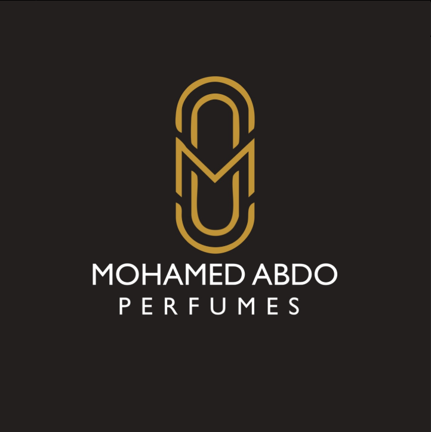

<div align="center">



<h1>
  <br/>
  <strong>MOHAMED ABDO PERFUMES</strong>
  <br/>
  <sub>منصة تعليم العطور العربية الفاخرة</sub>
</h1>

<p>
  <em>A premium Arabic perfume education platform — single-file landing page with cinematic scroll-scrubbed video hero</em>
</p>

<p>
  
  
  
  
  
</p>

<p>
  <a href="#-demo">Demo</a> •
  <a href="#-features">Features</a> •
  <a href="#-quick-start">Quick Start</a> •
  <a href="#-video-scrubbing">Video Scrubbing</a> •
  <a href="#-project-structure">Structure</a>
</p>

<br/>

   

</div>

---

## ✨ Features

| Feature | Details |
|---------|---------|
| 🎬 **Cinematic Scroll Video** | Full-screen hero video scrubs frame-by-frame with scroll — powered by GSAP ScrollTrigger |
| 🌍 **Arabic RTL First** | Native RTL layout with `dir="rtl"`, bilingual AR ↔ EN live toggle |
| 🎨 **Zero Build Tools** | Single `index.html` — Tailwind CDN + GSAP CDN, no npm, no webpack |
| 📱 **Fully Responsive** | Mobile (1-col) → Tablet (2-col) → Desktop (3+2 grid) |
| ⚡ **Smooth Animations** | GSAP ScrollTrigger entrance animations on cards, tracks, and sections |
| 🔍 **SEO Ready** | Semantic HTML5, proper `lang`, `dir`, Open Graph meta tags |
| 🌙 **Glassmorphism Nav** | Transparent → frosted glass nav on scroll |
| 📚 **5 Category Cards** | Custom gold SVG line-art icons, hover lift effect |
| 🏆 **Professional Tracks** | 3 horizontal course cards with RTL-safe gold border |

---

## 🚀 Quick Start

### Prerequisites
- [Node.js](https://nodejs.org/) v14+ (for the range-aware server)

### Run locally

```bash
# Clone the repo
git clone https://github.com/YOUR_USERNAME/mohamed-abdo-perfumes.git
cd mohamed-abdo-perfumes

# Start the range-aware server (required for video scrubbing)
node server.js

# Open in browser
# → http://localhost:9090/
```

> ⚠️ **Do not** open `index.html` directly (file://) or use Python's `http.server` — video scrubbing requires HTTP 206 byte-range responses which only the included `server.js` provides.

---

## 🎬 Video Scrubbing

The hero video scrubs **frame-by-frame with scroll** — scrolling down advances the video, scrolling up reverses it. This is the hardest part to get right. Here's the full recipe used in this project:

### The Problem
Most scroll-scrubbed video implementations are choppy. There are **3 independent root causes**, all must be fixed:

```
1. Sparse keyframes in source MP4  →  browser must backtrack to decode frames  →  chop
2. Python http.server (HTTP/1.0)   →  no byte-range support  →  video never loads
3. Video element not unlocked      →  Chrome blocks currentTime seeks until play() called
```

### The Fix

**1. Re-encode video with dense keyframes**

```bash
ffmpeg -i "input.mp4" \
  -c:v libx264 -preset slow -crf 23 \
  -g 1 -keyint_min 1 \
  -pix_fmt yuv420p \
  -an \
  -movflags +faststart \
  -y "output_scrub.mp4"
```

| Flag | Why |
|------|-----|
| `-g 1 -keyint_min 1` | Every frame is a keyframe → instant seek to any position |
| `-movflags +faststart` | `moov` atom at front → browser plays without full download |
| `-an` | Strip audio → smaller file |

**2. Range-aware Node.js server** — See [`server.js`](./server.js)

**3. JS pattern that works**

```js
const video = document.getElementById('hero-video');

function initScrollScrub() {
  const dur = video.duration;
  video.loop = false;
  video.pause();

  ScrollTrigger.create({
    trigger: '#hero-wrapper',
    start: 'top top',
    end: '+=220%',
    pin: true,
    scrub: 0,
    onUpdate: (self) => {
      video.currentTime = self.progress * dur;
    }
  });
}

// Unlock seeking, then init
video.addEventListener('canplay', () => {
  video.play()
    .then(() => { video.pause(); initScrollScrub(); })
    .catch(() => initScrollScrub());
}, { once: true });
```

> 📖 Full technique documented in [`.agents/skills/scroll-video-scrub/SKILL.md`](./.agents/skills/scroll-video-scrub/SKILL.md)

---

## 🗂 Project Structure

```
mohamed-abdo-perfumes/
│
├── index.html                               ← Entire frontend (single file)
├── server.js                                ← Range-aware Node.js HTTP server
│
├── Luxury_Perfume_Ad_Video_Generation.mp4   ← Original video (backup)
├── Luxury_Perfume_Ad_Video_Generation_scrub.mp4  ← Re-encoded all-keyframe video ✓
├── friend_logo.png                          ← Brand logo (gold monogram)
│
└── .agents/
    └── skills/
        └── scroll-video-scrub/
            └── SKILL.md                     ← Reusable scroll-scrub recipe for Claude
```

---

## 🎨 Design System

```
Gold     #C9A84C  ████  (primary accent)
Gold Lt  #D4AF77  ████  (hover/gradient)
Gold Dk  #A8883A  ████  (pressed/dark)
Cream    #FAFAF8  ████  (page background)
Dark     #1A1A1A  ████  (text/dark sections)
```

**Typography**
- Arabic: `Noto Naskh Arabic` — elegant, highly legible
- Latin / Labels: `Inter` — clean, modern

**Layout**
- Direction: RTL (`<html lang="ar" dir="rtl">`)
- Cards: `border-radius: 16px`, `box-shadow` lifted on hover
- Nav: Transparent → glassmorphism at 60px scroll

---

## 🧩 Tech Stack

| Layer | Technology |
|-------|-----------|
| Markup | HTML5, semantic elements |
| Styling | [Tailwind CSS](https://tailwindcss.com/) Play CDN |
| Animation | [GSAP 3.12.5](https://gsap.com/) + ScrollTrigger |
| Fonts | Google Fonts (Noto Naskh Arabic, Inter) |
| Server | Node.js built-in `http` module |
| Video | H.264 MP4, re-encoded with FFmpeg |

---

## 📐 Page Sections

1. **Sticky Nav** — transparent → glassmorphism, AR/EN toggle, mobile hamburger
2. **Hero** — pinned full-screen scroll-scrubbed video with headline + CTA
3. **Category Cards** — 5 cards (3+2 grid), gold SVG icons, hover lift
4. **Professional Tracks** — 3 course cards with gold RTL-safe border
5. **About** — dark section with brand logo + statement
6. **CTA** — gold gradient background, free signup call-to-action
7. **Footer** — dark, brand name in gold small caps, nav links

---

## 🔧 Customization

**Change video:**
1. Re-encode your video: `ffmpeg -i your_video.mp4 -g 1 -keyint_min 1 -movflags +faststart -an -y scrub.mp4`
2. Update `<source src="./scrub.mp4">` in `index.html`

**Change colors:**
Update the Tailwind config block in `index.html`:
```js
tailwind.config = {
  theme: {
    extend: {
      colors: {
        gold: { DEFAULT: '#C9A84C', light: '#D4AF77', dark: '#A8883A' }
      }
    }
  }
}
```

**Change scroll speed:**
In the `ScrollTrigger.create` call:
```js
end: '+=220%',  // increase for slower traversal, decrease for faster
scrub: 0,       // 0 = instant, 0.3 = slight lag, 1 = slow cinematic
```

---

## 📄 License

MIT © Mohamed Abdo Perfumes

---

<div align="center">
  <sub>Built with ❤️ and a lot of ffmpeg flags</sub>
  <br/>
  <sub>
    <strong>موسوعة العطور العربية</strong> — where fragrance meets education
  </sub>
</div>
